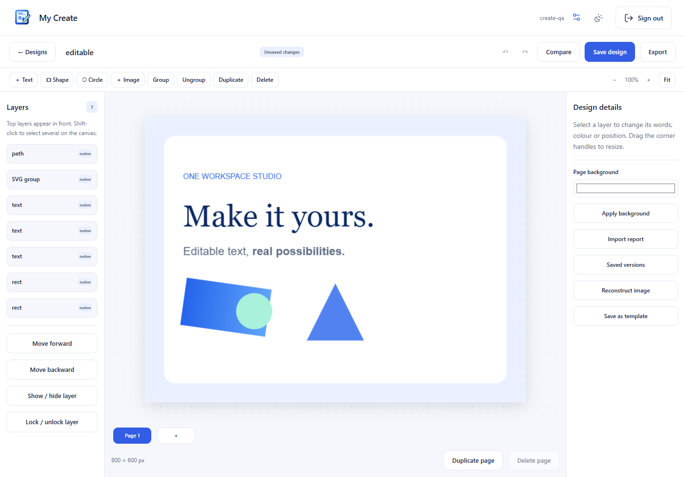

# My Create

Make invitations, flyers, social posts and multi-page designs in your own
[One Workspace](https://github.com/oneworkspacestudio/one-workspace).
Start with a template or bring an exported design and keep editing the text,
shapes and pictures that the file contains.

* Edit supported SVG and PowerPoint elements as real layers.
* Recover text and vectors from PDFs, with a visible report of conversion loss.
* Open images and layered PSD files. Optional Windows OCR and simple colour
  region detection create clearly labelled, reviewable reconstructions.
* Compare the source and result, substitute missing fonts, undo edits and save
  immutable project revisions.
* Export PNG, SVG or portable `.mycreate` packs; print all pages to PDF.
* Keep templates offline, or copy a pack to a folder you can access in My Drive.

## Get started

Install My Create through [One Workspace releases](https://github.com/oneworkspacestudio/one-workspace/releases)
and open **My Create** from the app grid. It uses your existing MyAccounts login.
For a standalone Windows installation, download the complete archive from
[My Create releases](https://github.com/oneworkspacestudio/my-create/releases),
extract it and run `MyCreate.exe`. Choose a private NTFS data folder; the browser
opens first-owner setup. See [setup and backup](docs/SETUP.md).

Choose **Import a design**, select a file, then choose Smart Editable,
Preserve Appearance or Maximum Editability. Review the comparison and warnings
before editing. The original file is retained even when conversion fails.

Import is a best-effort preview. Outlined text remains paths, raster images do
not contain original layers, and complex effects or unavailable fonts can change
appearance. PPTX comparison is a reconstructed reference, not an Office render.
PDF print export is rasterized. See the [format matrix](docs/RESEARCH.md) and
[tested limitations](docs/ACCEPTANCE.md).

Original, reusable designs are available in
[My Create Templates](https://github.com/oneworkspacestudio/my-create-templates).
Private designs are never published automatically. No Canva catalogue, scraping,
direct-link importer or Canva companion exporter is included.

For help, [open an issue](https://github.com/oneworkspacestudio/my-create/issues).
See [security](SECURITY.md), [scene format](docs/SCENE.md), and
[building and testing](docs/DEVELOPMENT.md). Code is Apache-2.0; supplied starter
designs are CC0. Imported assets retain their original licences.
